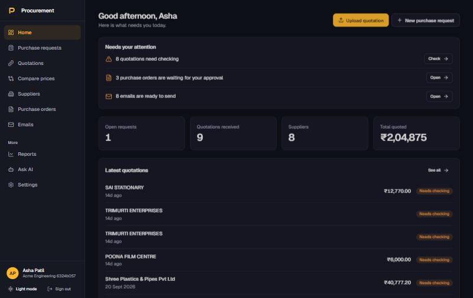
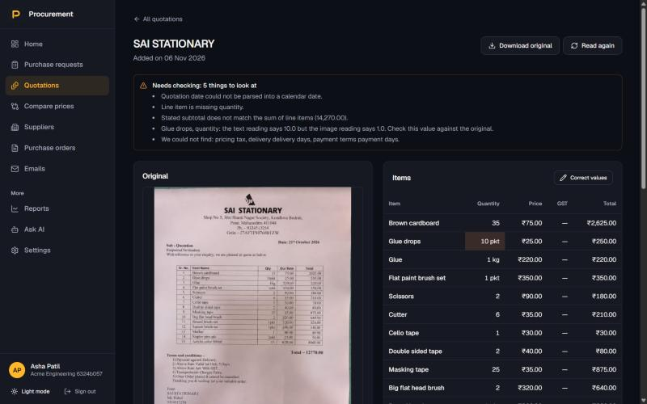

# Autonomous Procurement Assistant

An AI-assisted procurement platform for small and medium businesses in India: it reads supplier quotations from any source, ranks the suppliers with transparent rules, and drafts the negotiation and the purchase order for a person to approve.



## Table of Contents
- [About the Project](#about-the-project)
- [Tech Stack](#tech-stack)
- [Getting Started](#getting-started)
- [Usage](#usage)
- [Project Structure](#project-structure)
- [Roadmap](#roadmap)
- [Contributing](#contributing)
- [License](#license)

## About the Project
Small businesses collect quotations as PDFs, phone photos, spreadsheets and e-mails, retype the figures, compare them by hand and write purchase orders with the GST split themselves. It is slow, and one mistyped quantity or missed tax rate costs real money. Enterprise procurement suites solve this but are costly and need ERP integration.

This project automates that chain while keeping a person in charge:

- **Collect:** upload PDF, scan, photo, Excel (`.xlsx` and old `.xls`) or CSV, or collect automatically from Gmail (read-only).
- **Understand:** OCR where needed, AI extraction, then checks that every figure appears in the document, the arithmetic adds up, the GST number's check digit is valid, and a second reader looks at the page image and flags any amount the two readings disagree on.
- **Compare:** weighted scoring in code (price, delivery, payment terms, supplier reliability, other terms) with a written explanation. The language model never does arithmetic.
- **Act:** RFQ and negotiation e-mail drafts with a guardrail that stops them naming a competitor, and purchase orders with the correct CGST, SGST or IGST split, a PDF, and filing to Google Drive.
- **Decide:** a supervisor agent routes specialist agents (comparison, recommendation, risk, negotiation, purchase order), pauses for approval, and resumes. An assistant answers questions from your own records.
- **Learn:** calibrated late-delivery risk, price-error detection, spend reports, demand forecasts with a range, and HSN code suggestion from the official GST master.

Nothing is e-mailed by the app and nothing is ordered without a person approving it. Missing data stays missing instead of being guessed.



**Headline numbers** (re-measured with confidence intervals in [docs/VALIDATION_REPORT.md](docs/VALIDATION_REPORT.md)):

| Measure | Result |
|---|---|
| Late-delivery risk, ROC-AUC on 2,545 later USAID shipments | 0.832 [0.815 to 0.850], against 0.761 for the supplier's own record |
| Extraction, fields correct on 16 real quotations | 96.6 to 96.9% (typed documents about 98%; handwriting 56 to 67% on 2 documents) |
| HSN code, heading accuracy with the model | 91% on general goods, 98.8% on the easy benchmark |
| Price errors caught (team-supplied labelled file) | precision 0.75, recall 1.00 |
| Automated tests | 8,420 passing (8,000+ generated stress cases) |

**Team:** Vishwajeet Surve, Soham Joshi, Soham Mote and Atharva Sonje, Department of Computer Engineering, Vishwakarma Institute of Technology, Pune. Guide: Prashant L. Mandale.

## Tech Stack
- **Frontend:** React 19, TypeScript, Vite, Tailwind CSS, Radix UI, TanStack Query, Recharts
- **Backend:** Python 3.12, FastAPI, LangGraph (agents)
- **Database:** MongoDB 7 (Motor), every record scoped to an organization
- **AI:** Gemini, Groq and NVIDIA models behind one provider layer with automatic fallback (`vendor:model|vendor:model`); Gemini also reads page images and creates embeddings
- **Machine learning:** scikit-learn (random forest, isolation forest, Croston forecasting), TF-IDF and embedding search
- **OCR and documents:** Tesseract or RapidOCR, PyMuPDF, openpyxl, xlrd
- **Integrations:** Gmail API (read-only), Google Drive API, Google OAuth 2.0
- **Infrastructure:** Docker, Docker Compose, a one-service Render blueprint

## Getting Started

### Prerequisites
- Python 3.12 or newer
- Node.js 20 or newer
- MongoDB 7 listening on `127.0.0.1:27017` (or Docker, which brings its own)
- Optional: Tesseract OCR (faster scanned-photo reading; RapidOCR is used when it is missing)
- Optional: API keys for Gemini, Groq or NVIDIA, and a Google OAuth client for Gmail and Drive. Without keys the app still runs, using a rule-based reader and template drafts.

### Installation

1. Clone the repository:
   ```bash
   git clone https://github.com/Physics0070/Autonomous-Procurement-Assistant-.git
   cd Autonomous-Procurement-Assistant-
   ```
2. Install the backend dependencies:
   ```bash
   cd backend
   python -m venv .venv
   source .venv/bin/activate        # Windows: .venv\Scripts\activate
   pip install -r requirements.txt
   ```
3. Configure environment variables:
   ```bash
   cp .env.example .env
   # Set JWT_SECRET_KEY (python -c "import secrets; print(secrets.token_urlsafe(48))")
   # Add GEMINI_API_KEY / GROQ_API_KEY / NVIDIA_API_KEY and the Google OAuth values if you have them
   ```
4. Start the backend (from `backend/`):
   ```bash
   uvicorn app.main:app --port 8000
   ```
5. In a second terminal, start the frontend:
   ```bash
   cd frontend
   npm install
   npm run dev
   ```
6. Open <http://localhost:5173>, choose **Create one** on the sign-in page, and register a workspace.

**Or with Docker** (includes MongoDB and Tesseract):
```bash
cp .env.example .env     # set JWT_SECRET_KEY and any API keys
docker compose up --build
```
The web app is on <http://localhost:5173> and the API documentation on <http://localhost:8000/docs>.

Every setting, with its default and what happens without it, is listed in the [technical reference](docs/TECHNICAL_REFERENCE.md#environment-variables).

## Usage

In the app: **Upload quotation**, check anything marked "Needs checking" next to the original file, **Compare prices**, then **Negotiate** or **Award**. Drafts wait on the Emails and Purchase orders pages until you approve them.

Through the API (interactive documentation at `/docs`):

```bash
# sign in
curl -s -X POST http://127.0.0.1:8000/api/v1/auth/login \
  -H "Content-Type: application/json" \
  -d '{"email": "you@company.com", "password": "your-password"}'

# upload a quotation with the returned token
curl -s -X POST http://127.0.0.1:8000/api/v1/documents/upload \
  -H "Authorization: Bearer <token>" \
  -F "file=@backend/samples/quotation_new_bharat.pdf"
```

Checks and measurements (from `backend/`, MongoDB running):

```bash
pytest -q                                  # 8,000+ unit, API and stress tests, about 6 minutes
python -m ml.validate_numbers              # risk, price-error and forecast numbers with intervals
python scripts/measure_latency.py --ai     # API latency (needs DEMO_EMAIL and DEMO_PASSWORD set)
python scripts/make_samples.py             # regenerate the sample quotations
python -m ml.hsn dev test --llm            # HSN accuracy with the model (paced for free-tier limits)
```

The complete picture (all numbers, models, APIs and limits) is in the [final report](docs/FINAL_REPORT.md); more detail on the pipeline and design decisions is in the [technical reference](docs/TECHNICAL_REFERENCE.md).

## Project Structure
```text
├── backend/
│   ├── app/
│   │   ├── api/            # FastAPI routes
│   │   ├── services/       # documents, procurement, agents, automation, analytics, channels
│   │   ├── integrations/   # AI vendors, Gmail, Google Drive, storage
│   │   ├── repositories/   # MongoDB access, always scoped to an organization
│   │   └── workers/        # processing queue, Gmail scheduler, agent watchdog
│   ├── ml/                 # late-delivery risk, price errors, forecast, HSN, evaluation scripts
│   │   ├── data/           # SCMS loader and the team's labelled HSN, price and order files
│   │   └── artifacts/      # trained model and every evaluation report
│   ├── scripts/            # sample generators, demo seeding, latency measurement
│   └── tests/              # unit, API and generated stress tests
├── frontend/src/           # React app: pages, components, hooks
├── docs/                   # technical reference, validation report, roadmap, screenshots
├── Dockerfile              # one image serving the API and the web app
├── docker-compose.yml      # MongoDB, backend and frontend
├── render.yaml             # one-service deployment blueprint
└── README.md
```

## Roadmap
- [x] Quotation ingestion from upload and Gmail, with OCR and extraction
- [x] Validation, grounding check and image second reader
- [x] Deterministic supplier comparison and ranking with explanation
- [x] RFQ and negotiation drafts, purchase orders with GST, PDF and Drive filing
- [x] Supervisor and specialist agents with approval pause and resume
- [x] Late-delivery risk, price-error detection, forecast with range, HSN suggestion
- [x] Assistant with search over your own quotations and e-mails
- [x] Dark amber interface and the original file beside the extracted numbers
- [x] 8,000+ automated tests and a published validation report
- [ ] Faster photo reading: install Tesseract and clean images before OCR
- [ ] Reliable handwriting: make the page-image reading the main one for low-confidence scans
- [ ] Per-user rate limits and an AI spend cap, then a public deployment
- [ ] WhatsApp Business collection
- [ ] Check every page on a phone and in every state
- [ ] Verify Gmail end to end with a real mailbox

## Contributing
Contributions are welcome.

1. Fork the repository and create a branch: `git checkout -b feature/short-description`.
2. Make your change, and add a test for it. Logic that handles money, tax or extraction needs one.
3. Run `pytest -q` from `backend/` and `npx tsc --noEmit -p .` from `frontend/`; both must pass.
4. Commit with a message that says what changed and why, then open a Pull Request.

Never commit `.env`, API keys or customer documents.

## License
No open-source license has been chosen yet. Until one is added, all rights are reserved by the authors. Datasets: the late-delivery model uses the USAID Supply Chain Management System delivery history, published by USAID, and the HSN master comes from the GST portal.
